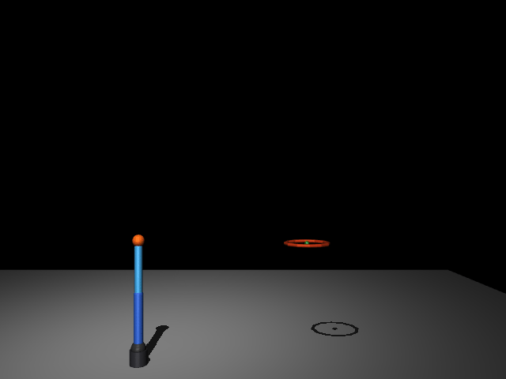

# Basketball Throwing RL

2-DoF planar robot arm with a free ball and fixed-time release. MuJoCo physics, Gymnasium environment, Stable-Baselines3 PPO/SAC, headless GIF export.

## 실행
### 환경 설정

```bash
conda create -n basketball_throwing_rl python=3.12 -y
conda activate basketball_throwing_rl
python -m pip install -r requirements.txt
```

### 학습
#### Tasks
1. target: 특정 점 위치로 공 던지기
2. hoop: 농구슛 모델

```bash
python ./scripts/train.py --algo [ppo,sac] --task [hoop,target] --timesteps [1_000_000]
```

### 평가

```bash
python scripts/evaluate.py --algo [ppo,sac] --model [path_to_parameter] --task [hoop,target] --episodes 100 --seed 10000 --out [path_to_output]
```

### Random policy 기반 action 시각화

```bash
MUJOCO_GL=egl python scripts/play_random.py --episodes 5 --out results/random_policy.gif
```



### 학습 결과 시각화

```bash
MUJOCO_GL=egl python scripts/play.py --algo ppo --model [path_to_parameter] --task [hoop,target] --episodes 3 --out [path_to_output]
```

